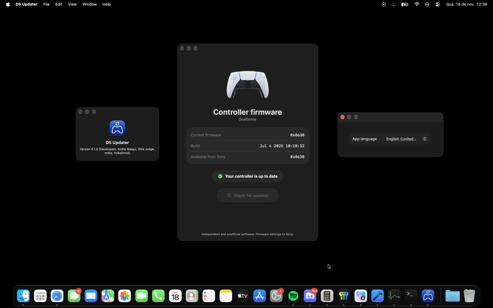

<div align="center">


# DS Updater

</div>

<div align="center">

## Contribuições

Se você gosta dos meus projetos, considere fazer uma pequena doação.

</div>

<div align="center">

<table>
  <tr>
    <th align="center">Chave pix ❖</th>
    <th align="center">Ethereum</th>
    <th align="center">Bitcoin</th>
  </tr>
  <tr>
    <td align="center">
      
    </td>
    <td align="center">
      
    </td>
    <td align="center">
      
    </td>
  </tr>
</table>

</div>


Interface gráfica para atualizar o firmware de controles DualSense e DualSense Edge no macOS. O app usa o [dsmactools](https://github.com/olliejudge/dsmactools) para detectar o controle, consultar a versão disponível e instalar o firmware.

> Este é um projeto independente e não oficial. O firmware pertence à Sony.

## Requisitos

- macOS 26 ou posterior
- Xcode 26 ou posterior, para compilar o projeto
- [Homebrew](https://brew.sh/) e `dsmactools`
- DualSense ou DualSense Edge conectado por um cabo USB de dados

## Instalação para desenvolvimento

```sh
brew tap olliejudge/tap
brew install dsmactools
git clone <URL-DO-SEU-REPOSITORIO>
cd DSUpdater
./build_app.sh
open DSUpdater.app
```

O script inclui o binário `dsmactools` dentro de `DSUpdater.app`. Também é possível passar um caminho explícito:

```sh
./build_app.sh /caminho/para/dsmactools
```

Para abrir o código no Xcode, escolha `File > Open…` e selecione a pasta que contém o `Package.swift`.

## Uso

<div align="center">



</div>

1. Conecte o controle com um cabo USB de dados.
2. Abra o app e confira a versão atual e a versão disponível.
3. Se houver uma atualização, escolha **Instalar firmware mais recente**.
4. Mantenha o Mac e o cabo conectados até a conclusão.

Não desconecte o controle nem feche o app durante a gravação do firmware.

## Criar um build para testes

```sh
./build_app.sh
ditto -c -k --sequesterRsrc --keepParent DSUpdater.app DSUpdater-1.0.1.zip
```

O app gerado é assinado ad-hoc. Para distribuição pública, assine com um certificado **Developer ID** e envie o app para notarização da Apple. Testadores podem precisar usar botão direito no app e escolher **Abrir** na primeira execução.

## Estrutura

- `Sources/DSUpdater`: código SwiftUI do app.
- `build_app.sh`: cria o bundle `DSUpdater.app` com o `dsmactools` embutido.
- `Info.plist`: metadados do bundle macOS.

## Créditos

O trabalho de comunicação com o controle e atualização de firmware é fornecido pelo [dsmactools](https://github.com/olliejudge/dsmactools).

## Licença

Distribuído sob a [licença MIT](LICENSE).
